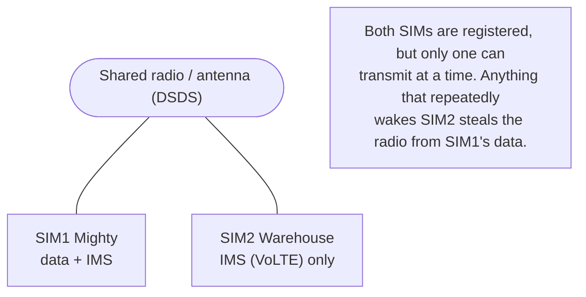
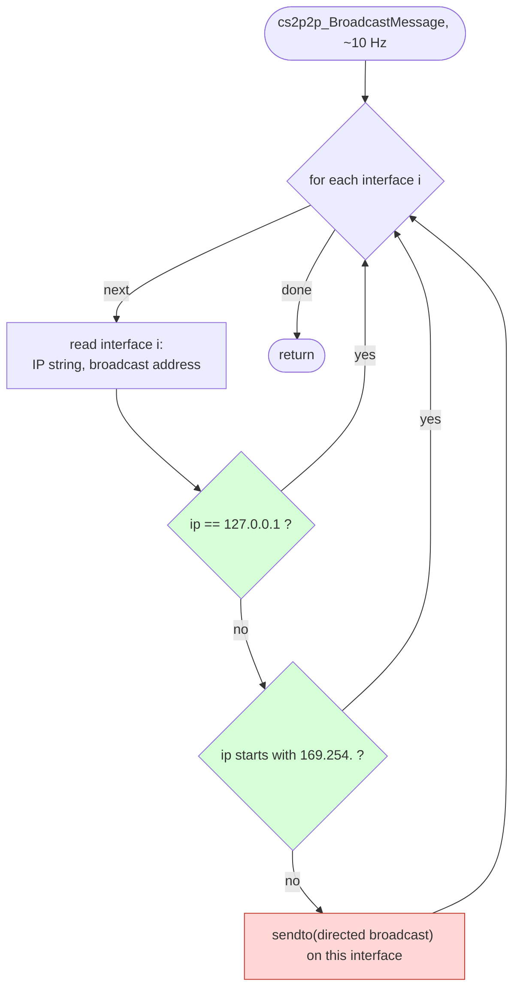
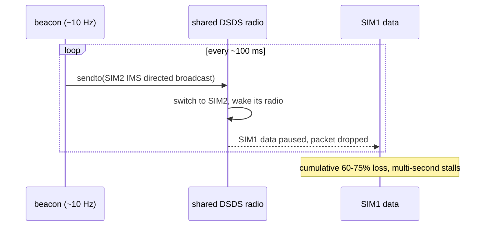
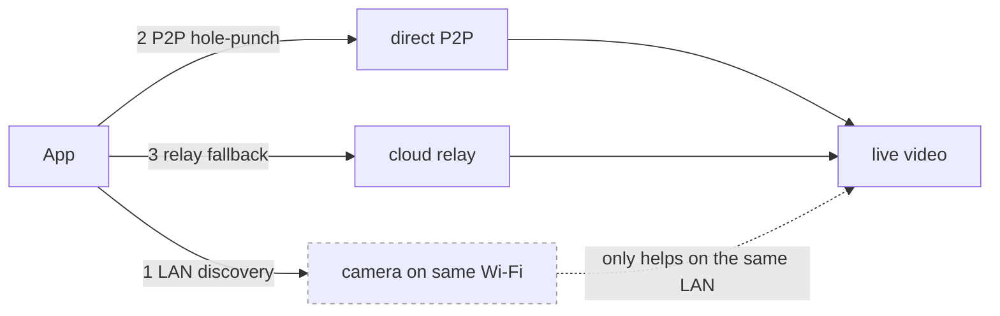
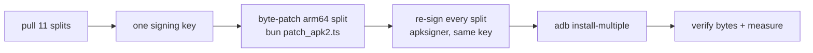

# Eufy Security dual-SIM mobile-data fix

## Purpose and Scope

This document records how the eufy Security Android app was made to work over mobile data
on a dual-SIM (DSDS) phone, by patching one instruction in a native library. It explains
the symptom, how the cause was measured, why it breaks a dual-SIM phone, the exact change,
how to build and install it, how it was verified, and how to carry it to a newer release.

It is a personal interoperability repair on my own device and my own paid copy of the app.
It distributes no eufy binaries. Not affiliated with Anker or eufy.

## Definitions

| Term | Definition |
| --- | --- |
| DSDS | Dual SIM Dual Standby: two SIMs are registered, but only one can use the radio at any instant. |
| IMS interface | The `rmnet` data connection a SIM brings up for VoLTE (IP Multimedia Subsystem). One per SIM, separate from the internet connection. |
| The beacon | `cs2p2p_BroadcastMessage` in `libmega_media_sdk.so`: the P2P stack's LAN device-discovery broadcast. |
| The device | The phone the measurements were taken on: Galaxy Z Fold7 SM-F966B, Android 17 / One UI 9. |
| Directed broadcast | A UDP packet sent to a subnet's broadcast address (e.g. `10.149.0.63`), which the kernel routes out the interface that owns that subnet. |

## Context

On the device, with both SIMs active, the eufy app cannot open a camera live view over
mobile data; it hangs. Thumbnails and notifications still arrive. On Wi-Fi, or with one
SIM, it works. This matches unresolved community reports going back to 2021.

The device runs two SIMs: Mighty (eSIM, the data SIM) and Warehouse (physical, calls and
SMS). Both keep VoLTE on because New Zealand has shut down 3G, so voice needs LTE. The
common community workaround — turning VoLTE off on the second SIM — is therefore not
available, the second SIM cannot be removed, and the app exposes no relevant setting. The
only remaining lever is the app's own behaviour.

The hardware constraint that makes this fatal:



## How it was diagnosed

Everything was measured over ADB, to replace folklore ("it binds to the wrong interface",
"use a VPN") with the actual mechanism. The sampler is [`tools/attrib_cap.sh`](tools/attrib_cap.sh).

The data link itself is broken whenever both SIMs are on, on a full-signal LTE connection:

```
$ adb shell ping -c 30 -i 0.5 8.8.8.8
30 packets transmitted, 12 received, 60% packet loss
rtt min/avg/max = 48.665 / 677.816 / 1983.635 ms
```

Three cellular interfaces exist — one carries internet, two are IMS (one per SIM):

| Interface | Address | Role |
| --- | --- | --- |
| `rmnet_data7` | `100.127.150.94/30` | internet (SIM1 data) |
| `rmnet_data8` | `10.73.92.167/28` | IMS (SIM1 VoLTE) |
| `rmnet_data1` / `data2` | `10.149.0.1/30`, `10.153.163.32/26` | IMS (SIM2 VoLTE) |

The sampler shows a constant ~10 packets/second on **both IMS interfaces**, at the same
rate whether live view is open or the app sits on the home screen. The sending sockets are
short-lived (open, send, close), so a point-in-time `/proc/net/udp` rarely catches one —
it is a tight ~100 ms loop. Four wrong theories fell out of this:

- Independent of live view → not the P2P/ICE connection path.
- Hits interfaces that carry no app data → it is a broadcast to every interface.
- P2P sockets bind `0.0.0.0` with a correct source → not a mis-bind.
- `getifaddrs` in the ICE path runs only during a connection → not the steady beacon.

Force-stopping the app is the causal A/B — every metric flips at once:

| Metric (both SIMs, mobile data) | App running | App force-stopped |
| --- | ---: | ---: |
| Beacon on the 2nd-SIM IMS interface | ~70 pkt / 10 s | 0 |
| `ping 8.8.8.8` loss | 60 % | 0 % |
| `ping` average RTT | 678 ms | 62 ms |

Re-opening the app, even to the home screen, restarts the beacon and the loss.

## Root cause

The steady beacon is `cs2p2p_BroadcastMessage` in `libmega_media_sdk.so` (vaddr `0x34a0a0`;
the P2P stack's `.../P2P/src/broadcast_interface.c`). A caller thread invokes it about ten
times a second. It walks every interface and, for each one that passes a filter, sends the
discovery packet to that interface's directed broadcast address from a fresh UDP socket.



The filter only looks at the interface's **IP address**
([`analysis/cs2p2p_BroadcastMessage.disasm.txt`](analysis/cs2p2p_BroadcastMessage.disasm.txt)):

| Check | Skips | Offset of the string |
| --- | --- | --- |
| `strcmp(ip, "127.0.0.1")` | loopback | `0x131290` |
| `strncmp(ip, "169.254.", 7)` | link-local | `0x131488` |

Everything else is treated as a real LAN, including the cellular IMS interfaces whose
addresses are ordinary `10.x` ranges. There is no interface-name check, and cellular `10.x`
cannot be told apart from a home LAN by IP, so the beacon broadcasts on the second SIM's
IMS interface. On a DSDS phone that wakes the second SIM's radio ten times a second:



LAN discovery is useless over cellular — the cameras are not on the cellular subnet — so
every one of these broadcasts is pure harm.

## The fix

Make the beacon return immediately, so it sends nothing on any interface. Remote live view
does not use it (see below), so nothing a user needs is lost.

| Field | Value |
| --- | --- |
| File | `lib/arm64-v8a/libmega_media_sdk.so` |
| Function | `cs2p2p_BroadcastMessage` |
| Offset (== vaddr) | `0x34a0a0` |
| Original | `fd 7b b2 a9  fd 03 00 91` → `stp x29,x30,[sp,#-0xe0]! ; mov x29,sp` |
| Patched | `00 00 80 52  c0 03 5f d6` → `mov w0, #0 ; ret` |

### Why this change

The three live-view connection paths are independent of the beacon:



Paths 2 and 3 carry live view remotely and over mobile data; path 1 (the beacon) adds
nothing over cellular. Disabling it removes the harm without removing the ability to watch
cameras away from home.

| Change | Why | Gain | Drawback introduced by the change |
| --- | --- | --- | --- |
| Return from `cs2p2p_BroadcastMessage` before it enumerates interfaces or sends | The filter only skips by IP, so cellular `10.x` interfaces can't be excluded at this site, and the beacon is useless over cellular anyway | No broadcast on any interface; the DSDS radio is no longer stolen | On Wi-Fi the app connects via cloud/relay instead of local direct discovery: live view still works, latency marginally higher |

The change is 8 bytes and length-preserving, so it is applied in place inside
`split_config.arm64_v8a.apk` (the `.so` is a STORED, 16 KB-aligned zip entry) without
re-zipping or re-aligning: [`tools/patch_apk2.ts`](tools/patch_apk2.ts) writes the bytes,
recomputes the entry's CRC-32 in the local and central headers, and the split is re-signed.

A name-based filter exists in a different library (`libeufy_link.so`'s pairing broadcast,
`strstr(name,"usb")` at `0x796fa`, repurposable to `"rmn"` to skip `rmnet*`). It was
investigated and left unapplied, because that path is the bounded device-binding broadcast,
not the steady beacon, and does not fix the problem on its own.

## Build and install

The app is an Android App Bundle (split APKs) hardened with ijiami. Two findings make the
repack viable: the ijiami shell does not verify the APK signature at startup (a re-signed,
unmodified build runs and logs in), and the native `.so` libraries sit outside the shell as
plain ELF. Bring your own copy of the splits — none are distributed here.

| Tool | For |
| --- | --- |
| `adb` | pull, install, measure |
| `apksigner`, `zipalign` (build-tools 35/36) | re-sign |
| `keytool` (JDK) | one throwaway signing key, reused for every rebuild |
| `bun` | run the byte patcher |
| `rizin` | re-find the offset on a new release |



```bash
# 1. pull every split listed by:  adb shell pm path com.oceanwing.battery.cam
# 2. one key, reused forever (same key => later installs keep your login)
keytool -genkeypair -keystore test.keystore -alias eufy -storepass eufytest \
  -keypass eufytest -keyalg RSA -keysize 2048 -validity 10000 -dname CN=eufytest
# 3. patch (refuses to run if the original bytes don't match)
bun tools/patch_apk2.ts  split_config.arm64_v8a.apk  patched.apk \
  lib/arm64-v8a/libmega_media_sdk.so  0x34a0a0  fd7bb2a9fd030091  00008052c0035fd6
# 4. apksigner sign --ks test.keystore ... every split
# 5a. first install (new signature): adb uninstall com.oceanwing.battery.cam; then install-multiple all splits (re-login once)
# 5b. later re-patches (same key, keep login): adb install-multiple -r <patched arm64> <other splits>
adb shell am force-stop com.oceanwing.battery.cam   # reload the .so
```

Git-Bash: `export MSYS_NO_PATHCONV=1` before any `adb … /data/local/tmp/…` or the path is
mangled. Verify the bytes landed with `dd` at `(apk data offset of the .so) + 0x34a0a0` and
expect `00008052c0035fd6`.

## Verification

Same harness, after installing the patched build, both SIMs on, live view open. Full logs:
[`analysis/captures/`](analysis/captures). TX packet delta per 2 s window:

```
AFTER: time      activity           data1(IMS)  data2(IMS)  data7(data)  data8(IMS)
       15:47:01  MediaLiveActivity  +0          +0          +64          +0
       15:47:09  MediaLiveActivity  +0          +0          +62          +0
       ...every cellular IMS interface stays +0; only the data interface carries video...
```

| Metric (both SIMs, mobile data) | Before | After |
| --- | ---: | ---: |
| Beacon on each IMS interface | ~10 pkt/s | 0 |
| `ping 8.8.8.8` loss | 60–75 % | 0 % |
| `ping` average RTT | ~670 ms | ~62 ms |
| Live view on mobile data | fails | works |

Confirmed on the device: live view opens and streams with both SIMs active on mobile data;
app launch, login, thumbnails, notifications and single-SIM/Wi-Fi live view are unchanged.

## Maintenance

The app now runs on a self-signed key, so Play cannot silently update over it — the patch
stays put. To move to a newer eufy release: get that version's splits, run the patcher at
`0x34a0a0` with the known original bytes; if they no longer match, re-find the function
(`rizin -q -c 'aa; afl~BroadcastMessage' libmega_media_sdk.so`, confirm it loops interfaces
with the `127.0.0.1` / `169.254.` filter), patch its first 8 bytes to `00008052c0035fd6`,
re-sign with the same key, `install -r`. Keep the key to preserve `-r` (login). Revert by
uninstalling and reinstalling from Play.

## Security and Privacy

- No eufy APK or `.so`, and no signing key, are committed — they are git-ignored and kept
  local. The repo holds only documentation, disassembly excerpts, strings and scripts, so
  it is reproducible from your own copy of the app.
- The fix removes outbound broadcasts; it adds no network endpoint and sends nothing new.

## Open Questions

- The ICE host-candidate path (`libmega_media_sdk` `udp_get_addrs`, `getifaddrs`) still
  enumerates interfaces briefly at connect time. It was not the steady beacon and needed no
  change; if a future release regresses here, apply the same "skip cellular" idea there.
- Whether a push notification waking the app in the background restarts any broadcast.

## References

- `analysis/` — native library inventory, `cs2p2p_BroadcastMessage` disassembly,
  `libeufy_link` filter, before/after captures.
- `tools/` — `patch_apk2.ts` (in-place byte patch + CRC), `attrib_cap.sh` (sampler),
  `build.sh`, `install.sh`.

### Appendix: bug report for eufy

> **Android app starves mobile data on dual-SIM (DSDS) phones — live view fails.**
> eufy Security 6.1.32 (32827), Android 17, Galaxy Z Fold7 (SM-F966B), two SIMs, VoLTE on
> both (DSDS); NZ has no 3G so VoLTE cannot be turned off. While the app runs (even on the
> home screen and in the background) it sends a UDP LAN-discovery broadcast to every
> interface about 10 times a second, including both SIMs' IMS interfaces. On a DSDS phone
> each broadcast on the non-data SIM's IMS interface wakes that SIM's radio and the data SIM
> loses the shared radio: 60–75 % packet loss, multi-second stalls, and the app's own P2P
> and HTTPS connections can't establish. Force-stopping the app drops the broadcast and the
> loss to zero. Fix: run LAN discovery only on Wi-Fi/Ethernet, never on cellular/IMS
> interfaces, and stop it in the background.
